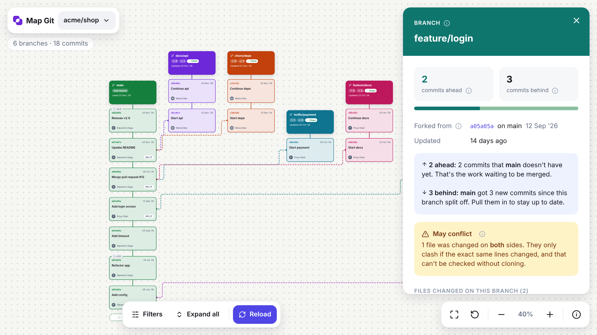

# Git Canvas

Git Canvas shows a GitHub repository as a map.
Each branch is a column. Each commit is a card.

**Open the page:** <https://dipanshudaga.github.io/Git-Canvas/>

## What you can see

- Branches as columns. Newer commits are higher.
- The place where each branch started, and the place where it merged.
- Merge conflicts between a branch and the main branch.
- Pull requests, CI results, and tags.

Click a card or a branch title. Git Canvas shows a plain explanation and the Git commands for that item.

## Open a repository

1. Open the Git Canvas page. The canvas opens at once, with the repository menu.
2. Paste a link to a public GitHub repository.
3. Press **Add**.

NOTE: A public repository needs no sign-in and no token.

You can also paste a link anywhere on the page. Git Canvas opens it.

## Share a map

Add `?repo=owner/name` to the page address.

Example: `https://dipanshudaga.github.io/Git-Canvas/?repo=tauri-apps/tauri`

Each person who opens the link sees the map.

## Know the limits

GitHub gives each network 60 anonymous requests each hour. One repository uses about 18 requests.

- Git Canvas keeps the results for 10 minutes. A second visit uses no requests.
- Without a token, Git Canvas loads the 12 branches with the newest pushes.
- Without a token, Git Canvas shows no CI results.
- A fork point older than 300 commits on the main branch has no line.
- A squash-merged branch looks unmerged. Squash merging changes the commits.

If GitHub refuses a request, Git Canvas shows the time to wait.

## Open a private repository (optional)

CAUTION: Make the token for your own use. Do not give it to other people. Paste it only into the official page.

1. Open <https://github.com/settings/personal-access-tokens/new>.
2. Select the private repository.
3. Give read-only access to **Contents**, **Pull requests**, **Metadata**, **Commit statuses**, and **Checks**.
4. Copy the token.
5. In Git Canvas, open the repository menu. Open **Advanced**.
6. Paste the token. Press **Save**.

NOTE: A token also raises the limit to 5,000 requests each hour and adds CI results.

The browser keeps the token. Git Canvas sends it only to `api.github.com`.

## Publish your own copy

1. Put this repository in your GitHub account.
2. Open **Settings**, then **Pages**.
3. Under **Build and deployment**, select **Deploy from a branch**.
4. Select the branch `main` and the folder `/ (root)`.
5. Press **Save**. Wait 1 or 2 minutes.
6. Open `https://<your-name>.github.io/<repository>/`.

## Use it on your computer

The local mode also reads folders on your computer. It uses your `gh` login and runs exact conflict checks.

Requirements:

- Python 3
- Git 2.38 or later
- GitHub CLI (only for GitHub repositories)

Procedure:

1. Download this repository.
2. Open a terminal in the folder.
3. Run `gh auth login`. Do this step only for GitHub repositories.
4. Run `npm run dev`.
5. Open <http://127.0.0.1:8765>.

NOTE: `npm run dev` installs nothing. It starts the Python server.

## How it works

The online page has no server. The browser sends requests to `api.github.com`. The browser draws the map.

Git Canvas has no account, no database, and no analytics. The page loads no scripts from other sites.

## Files

| File | Purpose |
|---|---|
| `index.html` | The page and all the code for the online mode |
| `gitdraw.py` | The local server. It reads Git folders and runs `gh` |
| `design/DESIGN-SYSTEM.md` | The colors, type sizes, and grid rules |
| `assets/` | The preview image |
| `favicon.svg`, `favicon.png`, `apple-touch-icon.png` | The page icons |
| `design/logo/` | The source file of the logo |
| `.nojekyll` | Tells GitHub Pages to publish the files as they are |

## Licence

MIT. See `LICENSE`.

Git Canvas is not made by GitHub.
